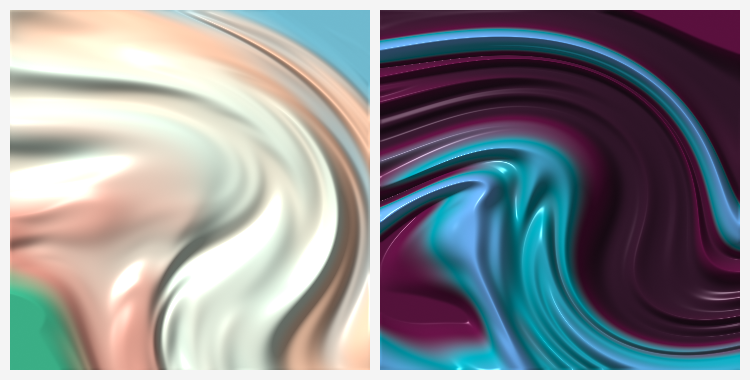

# swirlseed

Fluid, glassy marbling patterns generated from a string. Same text → same image, **byte for byte**; change one character and you get a different one.



One algorithm, three ways to use it:

| | what | where |
|---|---|---|
| **`swirlseed`** (Rust crate) | library, one optional dependency (NFC normalisation) | [`crates/swirlseed`](crates/swirlseed) |
| **`swirlseed`** (npm) | TypeScript library for browsers, Node, Bun, Deno | [`packages/swirlseed`](packages/swirlseed) |
| **`swirlseed`** (CLI) | local command-line tool, installed from `swirlseed-cli` | [`crates/swirlseed-cli`](crates/swirlseed-cli) |

The Rust and TypeScript implementations produce **identical pixels** for the same input. This is enforced by shared golden tests that run in CI (see [Byte-exact output](#byte-exact-output)).


## CLI

```sh
# install from the repo (no registry needed)
cargo install --git https://github.com/alexeev-dauwalter/swirlseed swirlseed-cli

swirlseed "Hello, world!"                      # → Hello_world.png, 1024×1024
swirlseed "Hello, world!" -o bg.png -s 1920x1080
echo -n "any text" | swirlseed - -o - > out.png # stdin → stdout
swirlseed "Hello, world!" --info                # print mood, mode and palette
```

Textures are separate, optional parameters. Passing any `--<effect>-*` option enables that effect:

```sh
swirlseed "Hello, world!" --halftone                                   # coloured dots
swirlseed "Hello, world!" --halftone-shape line --halftone-mode mono --halftone-angle 17
swirlseed "Hello, world!" --ribs --ribs-count 30 --grain               # reeded glass + film grain
swirlseed "Hello, world!" --dither-levels 3 --dither-scale 2.5         # retro, 3 levels per channel
swirlseed --help                                                       # everything
```


## TypeScript

```sh
npm install swirlseed
```

```ts
import { generate, drawToCanvas, createPattern, paletteHex } from "swirlseed";

// RGBA bytes, Uint8ClampedArray(width * height * 4)
const rgba = generate("Hello, world!", 1024, 1024, { halftone: { shape: "dot" }, grain: {} });

// browser: straight into a canvas (size = canvas.width × canvas.height)
drawToCanvas(document.querySelector("canvas")!, "Hello, world!", { ribs: { count: 24 } });

// what the seed decided
const params = createPattern("Hello, world!");
console.log(params.mood, paletteHex(params));
```

## Rust

```sh
cargo add swirlseed
```

```rust
use swirlseed::{generate, HalftoneOptions, RenderOptions};

let opts = RenderOptions { halftone: Some(HalftoneOptions::default()), ..Default::default() };
let rgba: Vec<u8> = generate("Hello, world!", 1024, 1024, &opts); // RGBA, width * height * 4
```

## Options

All effects are independent of the seed and off by default. `{}` / `Some(Default::default())` enables an effect with its defaults. Sizes (px) refer to a 512 px frame and scale with the real size, so a picture looks the same at 256 and at 2048.

| option | fields (defaults) |
|---|---|
| `shine` | `0…1.5` light and gloss; when omitted it is derived from the seed; `0` = flat |
| `ribs` | reeded glass: `count` 24 · `strength` 0.6 · `angle` 0 · `shade` 0.5 |
| `halftone` | `size` 10 · `angle` 30° · `shape` dot / square / line · `mode` color / mono · `invert` false · `mix` 1 |
| `dither` | ordered Bayer 8×8: `levels` 4 · `scale` 1.5 · `amount` 1 |
| `grain` | film grain: `amount` 0.35 · `size` 1 |

Angles are radians in the libraries and degrees in the CLI.

## How it works

```
string ─► cyrb128 (128-bit hash) ─► sfc32 (one independent stream per aspect: geometry, palette, noise)
       ─► parameters: palette (OKLCH, four "moods"), flow angle, swirl, 2–3 warp layers, …
       ─► swirl → rotate + stretch along the flow → domain warping (noise warped by noise)
       ─► scalar field → percentile normalisation → palette lookup (OKLab) → lighting (normals from the field)
       ─► [halftone] → [grain] → [Bayer dither] → RGBA
```

Because the generator is a pure function of the string, there is nothing to store: keep the seed and regenerate the picture anywhere.

## Byte-exact output

`Math.sin` and friends may differ in the last bits between JS engines, and from libm in Rust. swirlseed therefore does not use them: `sin`, `cos`, `exp`, `ln` and `pow` are implemented in [`dmath.ts`](packages/swirlseed/src/dmath.ts) and [`dmath.rs`](crates/swirlseed/src/dmath.rs) using only `+ − × ÷`, `floor` and `sqrt`, which IEEE 754 specifies exactly. Buffers are `f32` where the TypeScript code uses `Float32Array`, and final quantisation follows `Uint8ClampedArray` semantics (round half to even).

[`testdata/golden.txt`](testdata/golden.txt) holds a SHA-256 of the pixels for a set of seeds, sizes and effect combinations. Both test suites check against that one file, so any divergence between the two implementations fails CI. If you change the algorithm on purpose, regenerate it with `npm run golden` and commit the result (that is a breaking change for everyone who stores seeds, so bump the major version).

NFC: seeds are Unicode-normalised (NFC) so that `é` typed as one or two code points gives the same picture. In Rust this is the default `nfc` feature (it pulls in `unicode-normalization`); disable it with `default-features = false` if you only ever pass ASCII or already-normalised text.

## Development

```sh
# TypeScript
cd packages/swirlseed && npm install && npm test

# Rust
cargo test --workspace

# regenerate the pictures in docs/
cd packages/swirlseed && npm run build && cd ../.. && node scripts/make-gallery.mjs
```

## License

MIT, see [LICENSE](LICENSE).

## Demo site

`site/` contains a static demo (live generator and glass-UI examples) ready for Cloudflare Pages; see [site/README.md](site/README.md).
