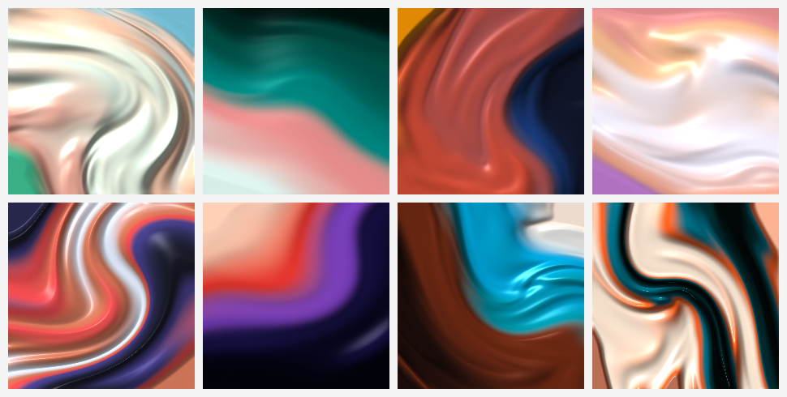
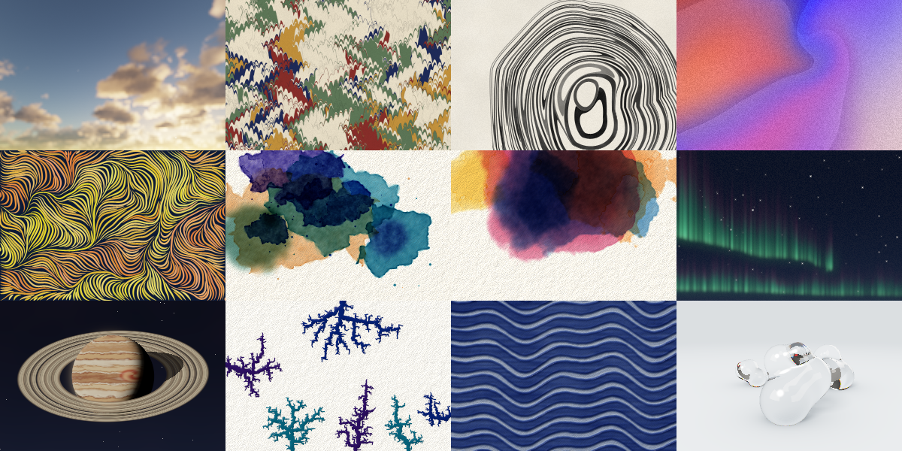
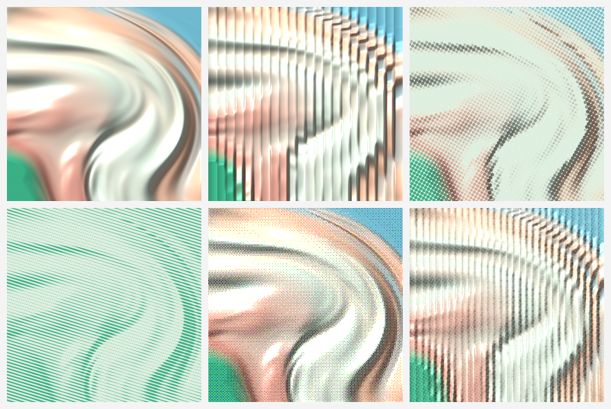

# swirlseed

Seeded generative images from a string: fluid, glassy marbling (the original *swirl*) and twelve more generators — a physically based sky, ebru, suminagashi, mesh gradient, flow field, watercolour, wet-on-wet, aurora, planets and nebulae, dendritic painting, paste paper and metaballs. Same text and parameters → same image, **byte for byte**; change one character and you get a different one.

**Demo:** [swirlseed.41t.dev](https://swirlseed.41t.dev) — every generator live, with the code to reproduce it.


One set of algorithms, three ways to use it:

| | what | where |
|---|---|---|
| **`swirlseed`** (Rust crate) | library, one optional dependency (NFC normalisation) | [`crates/swirlseed`](crates/swirlseed) |
| **`swirlseed`** (npm) | TypeScript library for browsers, Node, Bun, Deno | [`packages/swirlseed`](packages/swirlseed) |
| **`swirlseed`** (CLI) | local command-line tool, installed from `swirlseed-cli` | [`crates/swirlseed-cli`](crates/swirlseed-cli) |

The Rust and TypeScript implementations produce **identical pixels** for the same input. This is enforced by shared golden tests that run in CI (see [Byte-exact output](#byte-exact-output)).



## Generators



| id | what | parameters (defaults) |
|---|---|---|
| `sky` | Rayleigh/Mie/ozone single scattering, volumetric clouds, cirrus, sun, moon with phases, stars | `time` 17.6 h · `type` cumulus / stratocumulus / cirrus / stratus · `cover` 0.42 · `cirrus` 0.12 · `haze` 0.2 · `moon` 0.38 |
| `ebru` | Turkish paper marbling: dropped paint, combed and swirled | `style` battal / gel-git / tarakli / bulbul-yuvasi / hatip · `palette` auto … · `density` · `size` · `comb` |
| `suminagashi` | Japanese floating ink rings distorted by a breath | `ink` sumi / ai / sumi-ai / beni · `rings` 34 · `centers` 0 (auto) · `breath` 0.45 |
| `mesh-gradient` | OKLab colour fields with folded silk sheets, a vortex and grain | `palette` sky / sunset / lagoon / neon / mono / random · `folds` 2 · `soft` · `swirl` · `flow` · `grain` |
| `flow-field` | evenly spaced tapered streamlines over a noise field | `style` ink / neon / gold / sunset · `spacing` · `swirl` · `weight` · `length` |
| `watercolor` | transparent washes on cold-press paper: pooling, granulation, blooms, splatter | `palette` cobalt / sunset / forest / rose / sepia · `washes` 6 · `layers` 24 · `bleed` · `splatter` |
| `wet-on-wet` | pigment dropped onto soaking paper | `palette` dusk / ocean / bloom / earth · `washes` 5 · `flow` · `water` · `bloom` |
| `aurora` | folded emitting curtains in perspective over stars | `colour` green / violet / crimson / mixed · `intensity` · `curtains` 2 · `rays` · `stars` |
| `planets` | shaded worlds and domain-warped nebulae | `type` rocky / ice / gas-giant / ringed-giant / nebula · `sun` −55° · `size` · `clouds` · `water` |
| `dendritic-painting` | branching fingers grown by diffusion-limited aggregation | `palette` ink / cobalt / ember / spectrum / malachite · `origin` edges / centre / scatter · `fill` · `branch` · `weight` |
| `paste-paper` | combed or stamped starch paste lit as a relief | `pattern` waves / basket / rings / stamped · `colour` indigo / terracotta / forest / plum / ochre · `comb` · `wave` · `streak` |
| `metaballs` | ray-marched 3D blobs on a studio floor, or flat 2D graphics | `look` chrome / glass / glossy / lava / iridescent (3D), layers / gradient / drops / contour / holo (2D) · `balls` 10 · `size` · `merge` · `light` |

`swirlseed --list` prints every parameter with its range; the libraries expose the same specs (`GENERATORS` / `swirlseed::gen::GENERATORS`), which is what the demo site builds its controls from. Missing parameters take their defaults and unknown ones are an error.

## CLI

```sh
cargo install swirlseed-cli --locked

swirlseed "Hello, world!"                      # → Hello_world.png, 1024×1024
swirlseed "Hello, world!" -o bg.png -s 1920x1080
echo -n "any text" | swirlseed - -o - > out.png # stdin → stdout
swirlseed "Hello, world!" --info                # print mood, mode and palette
```

Textures are separate, optional parameters. Passing any `--<effect>-*` option enables that effect:

```sh
swirlseed "Hello, world!" --halftone                                   # coloured dots
swirlseed "Hello, world!" --halftone-shape line --halftone-mode mono --halftone-angle 17
swirlseed "Hello, world!" --ribs --ribs-count 30 --grain               # reeded glass + film grain
swirlseed "Hello, world!" --dither-levels 3 --dither-scale 2.5         # retro, 3 levels per channel
swirlseed --help                                                       # everything
```



Any other generator is one flag away. A single `-s` number is the width, and the height follows the generator's natural aspect ratio:

```sh
swirlseed --list                                        # generators and their parameters
swirlseed -g sky -p time=18.4 -p cover=0.6 -s 1920x1080 "evening"
swirlseed -g metaballs -p look=glass "Hello, world!"    # → metaballs-Hello_world.png
swirlseed -g planets -p type=ringed-giant -p sun=40 -s 2400 saturn
```

## TypeScript

```sh
npm install swirlseed
```

```ts
import { generate, drawToCanvas, createPattern, paletteHex } from "swirlseed";

// RGBA bytes, Uint8ClampedArray(width * height * 4)
const rgba = generate("Hello, world!", 1024, 1024, { halftone: { shape: "dot" }, grain: {} });

// browser: straight into a canvas (size = canvas.width × canvas.height)
drawToCanvas(document.querySelector("canvas")!, "Hello, world!", { ribs: { count: 24 } });

// what the seed decided
const params = createPattern("Hello, world!");
console.log(params.mood, paletteHex(params));
```

```ts
import { renderGenerator, drawGenerator, GENERATORS } from "swirlseed";

const sky = renderGenerator("sky", "evening", 1600, 1000, { time: 18.4, type: "cirrus" }); // RGBA
drawGenerator(canvas, "metaballs", "Hello, world!", { look: "glass" });
console.log(GENERATORS.map((g) => g.id)); // ids, titles, parameter specs
```

## Rust

```sh
cargo add swirlseed
```

```rust
use swirlseed::{generate, HalftoneOptions, RenderOptions};

let opts = RenderOptions { halftone: Some(HalftoneOptions::default()), ..Default::default() };
let rgba: Vec<u8> = generate("Hello, world!", 1024, 1024, &opts); // RGBA, width * height * 4
```

```rust
use swirlseed::gen::{render_generator, Value};

let params = [("time".to_string(), Value::Num(18.4)), ("type".to_string(), Value::Str("cirrus".into()))];
let rgba = render_generator("sky", "evening", 1600, 1000, &params)?; // Result<Vec<u8>, String>
```

## Swirl options

All effects are independent of the seed and off by default. `{}` / `Some(Default::default())` enables an effect with its defaults. Sizes (px) refer to a 512 px frame and scale with the real size, so a picture looks the same at 256 and at 2048.

| option | fields (defaults) |
|---|---|
| `shine` | `0…1.5` light and gloss; when omitted it is derived from the seed; `0` = flat |
| `ribs` | reeded glass: `count` 24 · `strength` 0.6 · `angle` 0 · `shade` 0.5 |
| `halftone` | `size` 10 · `angle` 30° · `shape` dot / square / line · `mode` color / mono · `invert` false · `mix` 1 |
| `dither` | ordered Bayer 8×8: `levels` 4 · `scale` 1.5 · `amount` 1 |
| `grain` | film grain: `amount` 0.35 · `size` 1 |

Angles are radians in the libraries and degrees in the CLI.

## How it works

The swirl pattern:

```
string ─► cyrb128 (128-bit hash) ─► sfc32 (one independent stream per aspect: geometry, palette, noise)
       ─► parameters: palette (OKLCH, four "moods"), flow angle, swirl, 2–3 warp layers, …
       ─► swirl → rotate + stretch along the flow → domain warping (noise warped by noise)
       ─► scalar field → percentile normalisation → palette lookup (OKLab) → lighting (normals from the field)
       ─► [halftone] → [grain] → [Bayer dither] → RGBA
```

The other generators follow their own physics or craft (single scattering and ray-marched clouds, marbling displacement maps, pigment layers on a paper height field, diffusion-limited aggregation, ray-marched implicit surfaces, …), but all of them draw every random number from the same seeded streams and rasterise without a canvas, with their own coverage-based polygon and stroke rasteriser.

Because every generator is a pure function of the string and its parameters, there is nothing to store: keep the seed and regenerate the picture anywhere.

## Byte-exact output

`Math.sin` and friends may differ in the last bits between JS engines, and from libm in Rust. swirlseed therefore does not use them: `sin`, `cos`, `exp`, `ln`, `pow`, `atan`, `atan2`, `asin`, `acos` and `cbrt` are implemented in [`dmath.ts`](packages/swirlseed/src/dmath.ts) and [`dmath.rs`](crates/swirlseed/src/dmath.rs) using only `+ − × ÷`, `floor` and `sqrt`, which IEEE 754 specifies exactly. Buffers are `f32` where the TypeScript code uses `Float32Array`, and final quantisation follows `Uint8ClampedArray` semantics (round half to even). The generators use `f64` throughout and round half up explicitly, and each Rust file in [`crates/swirlseed/src/gen`](crates/swirlseed/src/gen) mirrors its TypeScript twin in [`packages/swirlseed/src/gen`](packages/swirlseed/src/gen) expression by expression.

[`crates/swirlseed/testdata/golden.txt`](crates/swirlseed/testdata/golden.txt) holds a SHA-256 of the pixels for a set of seeds, sizes and effect combinations. [`generators.txt`](crates/swirlseed/testdata/generators.txt) does the same for 51 generator cases (every generator, every style). Both test suites check against those files, so any divergence between the two implementations fails CI. If you change the algorithm on purpose, regenerate it with `npm run golden` and commit the result (that is a breaking change for everyone who stores seeds, so bump the major version).

NFC: seeds are Unicode-normalised (NFC) so that `é` typed as one or two code points gives the same picture. In Rust this is the default `nfc` feature (it pulls in `unicode-normalization`); disable it with `default-features = false` if you only ever pass ASCII or already-normalised text.

## Development

```sh
# TypeScript
cd packages/swirlseed && npm install && npm test

# Rust
cargo test --workspace

# regenerate the pictures in docs/
cd packages/swirlseed && npm run build && cd ../.. && node scripts/make-gallery.mjs && node scripts/make-generators.mjs
```

## License

MIT, see [LICENSE](LICENSE).

## Demo site

`site/` is the static demo at [swirlseed.41t.dev](https://swirlseed.41t.dev): a catalogue of every generator with one shared seed, a page per generator (controls built from its parameter spec, variation strips, CLI / TypeScript / Rust snippets, PNG download) and glass-UI examples. It renders in Web Workers with the published package. See [site/README.md](site/README.md).
